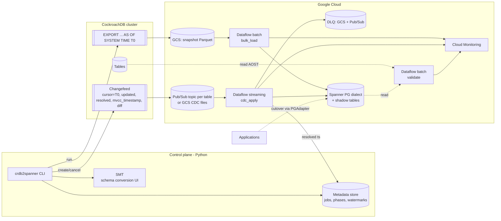

# Architecture: crdbtospanner

Version 0.1 (design) · Target: Cloud Spanner, **PostgreSQL dialect** · Runtime: Python 3.11+, Apache Beam on Dataflow

---

## 1. Goals and non-goals

**Goals**
- Minimal-downtime migration of CockroachDB databases to Spanner PG dialect, with downtime limited to a short write freeze at cutover.
- **Correctness under at-least-once, out-of-order CDC.** No lost updates and no resurrected deletes.
- A repeatable, DMS-like operating model: profiles, jobs, phases, status, gated cutover.
- Reuse Google tooling wherever it fits (SMT, DataflowTemplates patterns, DVT, PGAdapter), so the tool sits naturally alongside Google's own migration story.
- Scale out on Dataflow instead of a fixed worker pool.

**Non-goals (v1)**
- Application code conversion. The assessment *flags* application-impacting changes such as int4→int8, sequences and `unique_rowid()`.
- Automatic DDL propagation during replication.
- Bidirectional active-active replication. Reverse replication is for fallback only (M4).

---

## 2. Why not just use SMT / Datastream?

| Capability | Google stack for PostgreSQL | Works for CockroachDB? | Our approach |
|---|---|---|---|
| Assessment | DMA (PostgreSQL) | Partially. CockroachDB speaks the PG wire protocol, but its catalogue and features differ (`crdb_internal`, `REGIONAL BY ROW`, hash-sharded indexes, `unique_rowid()`) | **Own assessor**, CockroachDB-aware |
| Schema conversion | SMT (pg_dump or direct connect) | **Likely, after preprocessing** CockroachDB DDL into PG-compatible DDL (spike M0) | **Reuse SMT** with a preprocessing bridge, plus a built-in fallback converter |
| Schema-mapping contract | SMT session file | Yes, it's source-agnostic | **Reuse the session file format** as our mapping contract |
| Bulk load | Datastream backfill, or Dataflow `sourcedb-to-spanner` (JDBC, `POSTGRESQL` dialect) | Datastream: **no**. JDBC template: *possibly*, via the PG JDBC driver (spike), but it lacks `AS OF SYSTEM TIME` consistency control | **Own Python Beam batch job** over a consistent `EXPORT` snapshot. JDBC template is an optional alternative |
| CDC | Datastream (PostgreSQL logical replication) | **No.** Datastream lists no CockroachDB source, and CockroachDB's CDC mechanism is changefeeds | **CockroachDB changefeeds** → Pub/Sub or GCS |
| CDC apply | Dataflow `datastream-to-spanner` (Java) | Expects Datastream's event format | **Own Python Beam streaming job**, reusing the template's *design patterns*: shadow tables, retry/DLQ split |
| Validation | DVT | Probably, through its PostgreSQL connector (spike) | **DVT** for counts and aggregates, plus **own chunked row-hash job** |
| Reverse replication | `spanner-to-sourcedb` (MySQL, Cassandra) | No PostgreSQL / CockroachDB sink | **Own job** (M4): change streams → CockroachDB |
| App connectivity | PGAdapter | Yes | **Reuse PGAdapter** |

So the gap Google doesn't cover is the CockroachDB-specific *capture* and *apply* layer. Everything around it can be reused or matched.

---

## 3. High-level architecture



### Core consistency idea

1. Choose a snapshot time **T0** using `cluster_logical_timestamp()`. Protect it from garbage collection: run the export inside the GC window, or raise `gc.ttlseconds` for the migration's duration.
2. **Bulk** = every row as of T0.
3. **CDC** = a changefeed created with `cursor = T0`. It emits every change *after* T0, so there's no gap and no overlap.
4. Every applied mutation carries the CockroachDB **MVCC/HLC timestamp** of the change. The apply logic is *last-writer-wins by HLC per primary key*. That makes replays, duplicates and reordering harmless.

---

## 4. Components

### 4.1 Control plane (`control/`, `cli/`)

- **Typer CLI.** A thin Cloud Run API can come later, if a UI is wanted.
- **Job state machine:** `CREATED → ASSESSED → SCHEMA_APPLIED → SNAPSHOT_TAKEN → LOADING → LOADED → REPLICATING → VALIDATED → CUTOVER_READY → CUTOVER_DONE → (FALLBACK_ARMED) → CLOSED`.
- **Metadata store:** a small Spanner (or Firestore) database `crdb2spanner_meta`, holding jobs, tables, T0, changefeed IDs, Dataflow job IDs, per-table resolved watermarks, validation results and the audit log. This matches SMT's approach of a metadata database for live migrations.
- **Secrets** are kept in Secret Manager. No DSNs in config files.
- **Config:** one YAML file per job: source and target profiles, table include/exclude list, per-table overrides, and sink choice.

### 4.2 Assessor (`assess/`)

The assessor reads `information_schema`, `pg_catalog`, `crdb_internal` and `SHOW CREATE ALL TABLES`, plus table sizes and range counts.

**Output:** an HTML/JSON report with a traffic-light score per table and an effort estimate.

**Rule set (initial):**

| Finding | Severity | Remedy |
|---|---|---|
| No explicit PK (hidden `rowid`) | Blocker | Add an explicit PK before migration |
| `DEFAULT unique_rowid()`, `SERIAL`, monotonically increasing PK | High | Bit-reversed sequence, UUID, or shard-prefix key (avoids Spanner hotspots) |
| `INT4`/`INT2` columns | Medium | Map to `bigint`. Flag the application impact |
| Hash-sharded indexes (`USING HASH`) | Info | Drop the shard column. Spanner handles distribution |
| `REGIONAL BY ROW` / `GLOBAL` tables, `crdb_region` | High | Choose a Spanner multi-region config. Possibly geo-partitioning |
| Enums, arrays, `JSONB`, `INET`, `INTERVAL`, `BIT`, `TIME`, collated strings, geospatial | Varies | Per [docs/type-mapping.md](docs/type-mapping.md) |
| Computed / virtual columns | Medium | Spanner generated columns, or compute in the pipeline |
| Partial, inverted (GIN) and expression indexes | Medium | Rewrite or drop. Spanner full-text / JSON search where needed |
| Row-level TTL | Medium | Spanner TTL (row deletion policy) |
| Triggers, UDFs, stored procedures | High | Move to the app layer |
| Large rows / large `BYTES` columns | Medium | Check against Spanner mutation and cell limits |
| Write throughput per table | Info | Sizes Pub/Sub, Dataflow workers and Spanner nodes |

### 4.3 Schema conversion (`schema/`)

There are two modes. Both produce **the same artefacts**: Spanner PG-dialect DDL plus an **SMT-format session file**. The session file is the single source of truth for table, column and type mapping in every pipeline.

- **Mode A: SMT bridge (default).**
  1. Export the CockroachDB DDL.
  2. A preprocessor rewrites CockroachDB-only syntax into a PG-compatible "pg_dump-like" file. It strips `FAMILY`, `USING HASH`, `LOCALITY`, `INTERLEAVE` remnants and storage params, and normalises `STRING` → `text`.
  3. Load the file into SMT (PostgreSQL source, PG-dialect target). The architect makes the interactive decisions there: PKs, interleaving, sequences, skipped indexes.
  4. Export the session file.

  **M0 spike:** test SMT direct-connect against CockroachDB as an alternative.
- **Mode B: built-in converter.** A Python rules engine for headless or CI runs, and for constructs SMT can't handle.

**Apply order:**
1. Tables and PKs.
2. Shadow tables (if strict mode).
3. **Secondary indexes after bulk load.** Building them later is faster.
4. **Foreign keys and `INTERLEAVE IN PARENT` after cutover.** Use `INTERLEAVE IN` (non-enforcing) during the migration where interleaving is wanted.

### 4.4 Snapshot and bulk load (`pipelines/bulk_load.py`)

**Snapshot**
- `EXPORT INTO PARQUET 'gs://…/snapshot/<table>/' FROM SELECT * FROM <table> AS OF SYSTEM TIME '<T0>'`, run per table and in parallel.
- **Alternative (spike):** a changefeed with `initial_scan='only'`, `format=parquet` to a GCS sink. CockroachDB recommends changefeeds over `EXPORT` for large exports.

**Dataflow batch pipeline**
1. `ReadFromParquet`.
2. `ApplyMapping` (session file: renames, type transforms such as `INTERVAL` → text or ISO string, enum → text, `INET` → text).
3. Key transform (e.g. a bit-reversed or UUID surrogate, if the PK strategy changes).
4. `SpannerSink(mode=insert_or_update, commit_ts=T0)`.

**Ordering:** independent tables run in parallel. With interleaving enforced, load parent-first by topological order. In the default non-enforcing mode, order doesn't matter.

**Throughput:**
- Pre-split the Spanner table (split points API) for large tables.
- Group mutations by key range.
- Target roughly 100–500 KB mutation batches.
- Use Dataflow autoscaling with an upper worker bound tied to Spanner node count.

The `sourcedb-to-spanner` JDBC template is an **optional** alternative for very simple tables, if the spike shows it works against CockroachDB. It can't pin `AS OF SYSTEM TIME`, so it's only safe while the source is quiesced, or when combined with an earlier CDC cursor.

### 4.5 CDC capture

```sql
-- one changefeed per table (see crdb/changefeed.py)
CREATE CHANGEFEED FOR TABLE "db"."public"."t1"
INTO 'gcpubsub://<project>?topic_name=c2s-<job>-t1&region=<region>&AUTH=implicit'
WITH cursor = '<T0>', updated, mvcc_timestamp, resolved = '10s',
     min_checkpoint_frequency = '10s', on_error = 'pause',
     schema_change_policy = 'stop', format = 'json';
```

- **Sink choice:**

  | Sink | Pros | Cons | Use when |
  |---|---|---|---|
  | **Pub/Sub** (default) | Low latency, native Dataflow source, backpressure | 7-day retention, replay is harder | Steady-state CDC |
  | **GCS** (Firestore-guide pattern) | Durable and replayable, cheap, easy to audit | Higher latency (file flush interval) | Very large catch-ups, or regulated audit needs |

- **v0: one changefeed + one topic per table.** Each table can be restarted on its own and gets its own backlog. Grouping tables into fewer changefeeds is an M3 optimisation for databases with many tables.
- `schema_change_policy='stop'`: a source DDL change stops the feed safely. The operator then follows the schema-change runbook.
- `on_error='pause'` plus monitoring of `SHOW CHANGEFEED JOBS`. The control plane alerts on, and can resume, paused feeds.

### 4.6 CDC apply (`pipelines/cdc_apply.py`): the core

```
ReadFromPubSub(per-table subscriptions, with_attributes)
  → ParseEnvelope            # after | null (delete), key[], updated, mvcc_timestamp, or resolved
  → Partition: data vs resolved
      resolved → UpdateWatermark (min across partitions/topics) → metadata store + metric
      data     → MapToTarget (session file; type transforms; PK transform)
               → KeyBy((table, pk))
               → LatestWinsDoFn  [stateful: ValueState(max_hlc) per key; drop if hlc <= max_hlc]
               → BatchByTableAndKeyRange (GroupIntoBatches w/ max size + max latency)
               → SpannerApply
                   fast mode   : InsertOrUpdate / Delete mutations (blind writes)
                   strict mode : RW txn → read shadow_<table>._hlc for keys → apply only newer → upsert shadow
               → Results: success | retryable (e.g. parent missing, aborted) | permanent (type/size error)
                   retryable → retry with backoff (bounded) → DLQ-retry topic
                   permanent → DLQ-severe (GCS JSON) for operator reprocessing
```

**Correctness rules**
- **At-least-once, per-key ordering only.** CockroachDB guarantees per-key order for first emission, but duplicates can arrive in any order, and Dataflow doesn't preserve Pub/Sub order. HLC comparison per key is therefore mandatory.
- **Deletes** are applied as `Delete` mutations, *and* the tombstone HLC is recorded (in state or the shadow table). A late, stale upsert then can't bring the row back.
- **Fast mode vs strict mode.** In-memory Beam state is lost if the job is replaced without `--update`/drain. **Strict mode** stores `_hlc` per key in Spanner shadow tables, so correctness survives restarts and replays. This is the same pattern Google uses in `datastream-to-spanner`. **Strict mode is the default for production.** Fast mode is for catch-up of append-only tables.
- **PK changes** on the source arrive as delete(old) + insert(new), so no special handling is needed.
- **Transactions:** changefeeds don't preserve transaction boundaries. Spanner sees each row's final state but not the source's multi-row atomicity. At cutover, after the backlog drains past the freeze timestamp, the target is consistent as of that point.

**Spanner writes (PG dialect)**
- The default sink is a **native Python DoFn** using `google-cloud-spanner`. Mutations are dialect-agnostic. It uses `batch()` / `run_in_transaction` and `max_commit_delay` for throughput, with session pooling per worker.
- Beam's cross-language `WriteToSpanner` (Java expansion service) is an alternative. PG-dialect support through the Python wrapper still needs verification (M0).
- Writes are idempotent by design, since upserts are guarded by HLC.

### 4.7 Watermarks, lag and cutover gating

- **Per-table resolved watermark** = the minimum resolved timestamp seen across that table's partitions, **after** all preceding data messages for it have been applied. This is implemented with Beam event-time watermarks: resolved messages advance a per-table custom watermark.
- **Metrics:** `replication_lag_seconds = now − watermark`, `backlog_messages` (Pub/Sub undelivered), `dlq_count`, `apply_rate`, `stale_dropped`.
- **Cutover preconditions** (`cutover prepare`):
  1. All validations green.
  2. DLQ empty or signed off.
  3. Lag below a threshold (e.g. 5 s).
- **Cutover sequence** (`cutover complete`):
  1. App write freeze, or switching CockroachDB users to read-only.
  2. Record `T_freeze`.
  3. Wait until every table's watermark is at or past `T_freeze` and the backlog is 0.
  4. Final quick validation (counts plus sampled hashes).
  5. Switch the app connection string to PGAdapter / Spanner.
  6. Cancel the changefeeds and drain Dataflow.
  7. Add FKs and indexes deferred to after cutover.

### 4.8 Validation (`pipelines/validate.py`)

- **Level 1 + 2 (implemented, v0).** Read the source as a consistent snapshot `AS OF SYSTEM TIME t`. Read the target once replication has applied everything up to `t`. Map each row through the same transforms, then hash it into B buckets by PK. Because this is order-independent, PK transforms such as the bit-reversed `rowid` still work. Compare row counts and bucket sums, and drill into mismatched buckets to list the differing keys. The result is **exact** at the cutover write freeze, or once test traffic stops.
- **Live validation (M2):** while writes continue, exclude keys whose shadow-table HLC is greater than `t`, so in-flight changes don't show up as false mismatches. Also add a Beam/Dataflow version of the scan for very large tables.
- **Level 3:** column aggregates (sum, min, max, null counts) through **DVT**, if its PostgreSQL connector works against CockroachDB (spike).
- **Normalisation layer:** decimals, timestamps (`timestamptz` precision, microseconds vs nanoseconds), JSON key order, float edge cases and array encoding.

### 4.9 Reverse replication (M4)

Spanner change stream → Python Beam (`ReadChangeStreamFromSpanner` via cross-language, or the Java template pattern) → transform back through the session file → `psycopg` upserts into CockroachDB, guarded by commit timestamp.

To prevent loops, the forward CDC is stopped at cutover, so there's no ping-pong. If both run concurrently during testing, writes made by the reverse job are tagged with a transaction tag, and those changes are filtered out.

---

## 5. Type mapping (summary; full matrix in `docs/type-mapping.md`)

| CockroachDB | Spanner PG dialect | Notes |
|---|---|---|
| `INT8` / `INT` / `INT4` / `INT2` | `bigint` | Spanner PG has 8-byte ints only |
| `FLOAT8` / `FLOAT4` | `double precision` / `real` | |
| `DECIMAL(p,s)` | `numeric` | Check precision limits; validate scale |
| `STRING` / `VARCHAR(n)` / `CHAR` | `varchar(n)` / `text` | |
| `BYTES` | `bytea` | Check cell size |
| `BOOL` | `boolean` | |
| `DATE` | `date` | |
| `TIMESTAMP` / `TIMESTAMPTZ` | `timestamptz` | Timezone normalisation for `TIMESTAMP` |
| `TIME`, `TIMETZ`, `INTERVAL` | `varchar` (ISO) or `bigint` | Application impact. Spanner PG `interval` support to be checked per version |
| `UUID` | `varchar(36)` or `uuid` | Depends on current Spanner support. Decide in M0 |
| `JSONB` | `jsonb` | `json` → `jsonb` |
| `ARRAY<T>` | `T[]` | No nested arrays |
| `ENUM` | `varchar` + CHECK constraint | |
| `INET`, `BIT`, `GEOMETRY` | `varchar` / `bytea` | Or redesign |
| `SERIAL`, `unique_rowid()` | bit-reversed `sequence` / UUID | Hotspot avoidance |

---

## 6. Packaging and deployment

- **Python package** `crdb2spanner` (Poetry or uv), with the CLI entry point.
- **Dataflow Flex Templates**, one per pipeline (`bulk_load`, `cdc_apply`, `validate`, `reverse`). The container image is built in Cloud Build and stored in Artifact Registry. This allows launches from the CLI, Console or Composer.
- **Terraform module** `terraform/`: GCS buckets, Pub/Sub topics, subscriptions and DLQs, service accounts and IAM, Spanner metadata DB, Monitoring dashboard and alerts, VPC/PSC.
- **Orchestration:** the CLI is enough for v1. Cloud Workflows or Composer can be used for multi-wave programmes.

## 7. Observability

- A Cloud Monitoring dashboard per job: lag, backlog, apply rate, DLQ, stale drops, Spanner CPU, and changefeed status (pulled from CockroachDB by the control plane).
- Alerts: lag > X, changefeed paused, DLQ > 0, Dataflow job failed, Spanner CPU > 65% (high priority).
- Structured logs with `job_id`, `table` and `pk_hash` in all components.

## 8. Scale and performance assumptions (to be validated in M0/M3)

- Spanner sizing: about 1 node (1000 PU) per ~10–20k writes/s, depending on row size and indexes. Scale up for the bulk phase, then down.
- Dataflow: streaming engine on. Autoscaling capped so it can't overrun Spanner.
- Changefeed: tune `min_checkpoint_frequency`, `resolved` and the Pub/Sub sink batching options against CockroachDB CPU overhead.

## 9. Security and networking

- Separate service accounts per component: control plane, Dataflow worker, CockroachDB-to-GCP sink identity. Least privilege applies throughout: `spanner.databaseUser` on the target, `pubsub.publisher` for the sink identity only.
- CockroachDB credentials and sink credentials are kept in Secret Manager.
- Connectivity: CockroachDB has to reach Pub/Sub and GCS (Private Google Access / PSC over Interconnect or VPN for self-hosted clusters). Dataflow has to reach CockroachDB for validation and reverse replication.
- CMEK on GCS, Pub/Sub and Spanner, where the client requires it.
- PII: the DLQ stores row data, so it gets the same retention and access controls as the source.

## 10. Testing strategy

- **Unit:** envelope parsing, type transforms, the LWW DoFn (property-based tests with shuffled, duplicated events).
- **Pipeline:** Beam `TestStream` on DirectRunner for out-of-order, duplicate and late events.
- **Integration:** CockroachDB in Docker + Spanner emulator (PG dialect) + Pub/Sub emulator, running in CI.
- **Chaos:** kill and restart Dataflow mid-stream, pause and resume the changefeed, replay Pub/Sub from a snapshot. Then verify validation is 100% green.
- **Scale:** a TPC-C-like workload on a staging CockroachDB cluster at production-like volume.

## 11. Open decisions

| # | Decision | Options | Owner / when |
|---|---|---|---|
| D1 | Project licence | EPAM proprietary vs Apache-2.0 | EPAM legal, before M1 |
| D2 | Snapshot mechanism | `EXPORT` vs changefeed `initial_scan='only'` | M0 spike |
| D3 | CDC sink | Pub/Sub vs GCS, or both | M0 spike |
| D4 | Spanner sink | Native DoFn vs cross-language SpannerIO | M0 spike |
| D5 | Default apply mode | Strict (shadow tables) vs fast | Proposed: strict |
| D6 | Metadata store | Spanner vs Firestore | M1 |
| D7 | Multi-region mapping | Per client topology | Discovery |
| D8 | UUID / interval / time handling in Spanner PG | Native vs varchar | M0, check current Spanner PG feature set |
